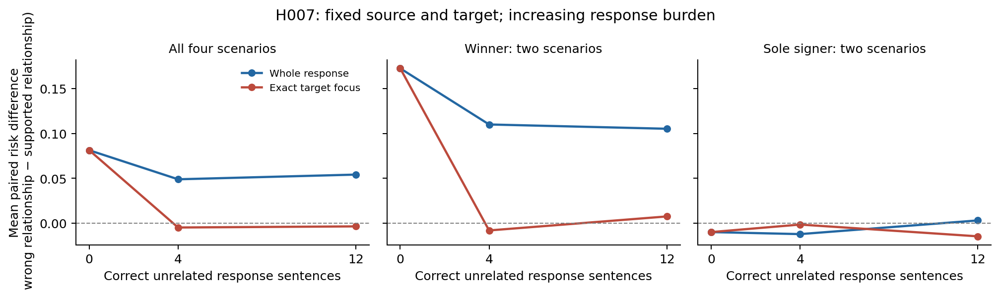

# H007：关系方向×回答负担，新控制否定焦点补救假设

**结果：不晋升。** 固定 Qwen2.5-3B NF4、完整来源与目标首句，增加来源已明确支持的无关回答后缀后，精确焦点的关系分离变差；预先固定的交互为 **−0.057753**。不能把“拆出焦点就能消除判定负担”作为当前方法的机制依据。这里测量的是这个检测接口对受控输入的响应，不是原回答生成器的内部致错过程。

材料在模型前固定：2 关系族×2 词汇实例×2 来源方向×2 回答方向×3 正确干扰句数，共 48 原回答。每个来源方向始终含相同的全部 12 条 filler 事实；目标是首个自动原文单元，两端都含两个并列断言及固定尾空格。全部 96 个判定范围和六种标签分配保留，无阈值/权重/模型选择。实际 480 次前向、96 次精确复用、329844 输入 token，前向合计 107.995329 秒，零拒绝/未知；模型加载、文件封存和 CPU 核验时间另计。

| 正确后缀句数 | 整答配对差 | 焦点配对差 | 整答正确方向 | 焦点正确方向 | 整答构造 AUROC | 焦点构造 AUROC |
|---|---:|---:|---:|---:|---:|---:|
| 0 | 0.081394 | 0.081394 | 5/8 | 5/8 | 0.578125 | 0.578125 |
| 4 | 0.048990 | -0.004770 | 6/8 | 2/8 | 0.593750 | 0.421875 |
| 12 | 0.054225 | -0.003528 | 5/8 | 2/8 | 0.546875 | 0.437500 |

配对差为“错误关系风险−正确关系风险”，正值才是正确方向。零负担时两个范围请求完全相同，结果也完全一致；即使如此，8 对中只有 5 对顺序正确，说明最简关系核验本来就没有稳定通过。winner 与 sole_signer 的全配对、两组词汇、两个来源方向均保留在 JSON 中，不能只挑 winner 或某种名字展示成功。图不添加不适用的独立大样本误差线。

在固定关系族和词汇实例中，四格交叉对比为

\[
B_m(b)=\tfrac12(h_{01}^m+h_{10}^m-h_{00}^m-h_{11}^m).
\]

程序再对四个 scenario 等权平均得到 \(\bar B\)。若风险是来源偏好、回答偏好和错误绑定项的加性和，四格对比会抵消前两项；非加性词汇/位置交互仍可能进入结果。预先固定的主量为

\[
I=[\bar B_{target}(12)-\bar B_{target}(0)]-[\bar B_{whole}(12)-\bar B_{whole}(0)].
\]

本轮 \(I<0\)，方向与拟议补救相反；它不是统计显著性声明。完整推导与边界见 [THEORY](../../refine-logs/h007-20261103/THEORY.md)。后缀逐字来自同一 filler 集合、目标固定首位且首句含两个断言，均限制外推。

可以由已有请求直接推知：删除全部回答后缀后，各负担的输入恰好退回零负担请求。应复用其缓存，不能再跑一次并把它当作新改进；该对照也仍然只有 5/8 正确方向。当前证据同时留下基本绑定能力、标签读出及上下文处理的瓶颈，不能只归因于长回答，更不能由检测器实验断言原生成机制。

下一入口必须更换可检验的观测机制，例如用程序确定的精确槽位避开 H002 失败的自由索引提议，再测试值盲来源重建；或者先让独立标准核验头通过关系资格，确定所用观察器具备必要能力。它们尚未在本报告中执行，也不能仅凭这里的负结果宣称有效。六项主任务各 0.8 仍未达成；构造 AUROC 不替代任何自然任务成绩。

观察与 CPU 评价均封存且完成登记；CPU 先重建全部请求、成本和读出并冻结评价计划，再读取独立构造真值。完整记录在 [结果 JSON](h007_response_burden.json) 及 outputs/h007-burden-20261103 下的冻结产物。
