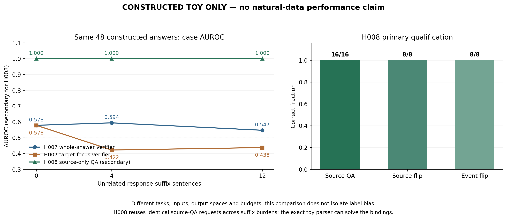

# H008：来源重建在有限构造资格上通过，不晋升

固定 Qwen2.5-3B-Instruct 在 8 个来源、16 个独立来源问题上全部选对完整人名，0 个 tie；8 个来源翻转与 8 个事件翻转配对均正确反向。原 48 个构造回答的最大槽位风险得到次级 AUROC/AP=1.0，96 个原槽位全部保留，0 个未知回退。这是已暴露、严格语法且可由 parser 直接解答的 toy 资格结果，不能称为自然数据检测效能、六任务各 0.8、LLM 必要性或新颖性证明。

设计与限制见观察前固定的 [H008 DESIGN](../../refine-logs/h008-20261103/DESIGN.md)。机器结果 [h008_source_reconstruction.json](h008_source_reconstruction.json) 保留全部 16 个 query、32 条完整 completion 原始观测与 48 个回答记录，不挑选案例、参数或表现较好的分支。

48 答是 2 关系族 × 2 词汇实例 × 2 来源方向 × 2 回答方向 × 3 回答负担（0/4/12）的原全组。相同来源只问两个固定事件问题，每问都评分来源中规范排序的两个人名，实际仅 8×2×2=32 次前向；三个负担水平映射到同一组来源 QA 观测，不能当作 48 个独立重建样本。

模型前缀只有来源 S 与来源决定的问题 Q，不含原回答 R 或其原槽值。完整候选名来自来源域，作为 teacher-forced completion 计分；每个人名的全部 4 或 5 个 tokenizer token 后再计一个固定 EOS。没有生成文本，没有 A/B/C 语义类别，也没有单独截取末尾 token 代替姓名。令 \(y\) 为完整候选 token 后接 EOS，则

\[
\ell_{q,c}=\sum_{t=1}^{K_c+1}\left[z_{q,c,t}(y_t)-\log\sum_{v\in V}\exp z_{q,c,t}(v)\right],
\qquad y=(\operatorname{tokens}(c),\mathrm{EOS}).
\]

每个因果位置的目标 raw logit、全词表 float64 log-sum-exp、log probability 和完整 joint sum 均封存。固定两候选域中的条件概率与槽位风险为

\[
\widetilde p(c\mid S,Q,\mathcal C)=\frac{\exp\ell_{q,c}}{\sum_{c'\in\mathcal C}\exp\ell_{q,c'}},
\qquad r_{\mathrm{slot}}=1-\widetilde p(c_{\mathrm{original}}),\qquad
r_{\mathrm{case}}=\max_{\mathrm{two\ original\ slots}}r_{\mathrm{slot}}.
\]

这里没有长度归一化、温度拟合、阈值搜索、标签选择或事实概率标定。候选姓名 token 数为 4 的 completion 有 20 条，为 5 的有 12 条；姓名长度/频率偏好没有被消除。16 个问题的两候选完整序列总质量范围为 **0.9986869974–0.9999388105**；这与候选条件概率分别保留，不能把高 pool mass 当作事实正确性或域外完整性的保证。

| 固定评价项 | 原始单位 | 结果 |
|---|---:|---:|
| 来源 QA greedy 正确 | 16 个独立问题 | 16/16，0 tie，0 wrong |
| 来源方向翻转正确反向 | 8 个配对 | 8/8 |
| 同来源事件翻转正确反向 | 8 个配对 | 8/8 |
| 次级原回答最大槽位风险 | 48 答，24 错/24 对 | AUROC=1.0，AP=1.0 |
| 原槽位覆盖 | 96 个精确文本槽 | 96/96，0 unknown |

下面保留同一 48 答上 H007 的全部负担分层 AUROC，作为不同观察接口的并列背景。H007 对整答或精确目标单元核验；H008 则问来源事件并评分完整名字。二者改变了输入、任务、输出空间、重复复用与计算量，不能唯一归因为标签偏好，也不是同预算比较。

| 回答后缀负担 | H007 整答 AUROC | H007 目标焦点 AUROC | H008 最大槽位 AUROC（次级） |
|---:|---:|---:|---:|
| 0 | 0.578125 | 0.578125 | 1.000000 |
| 4 | 0.593750 | 0.421875 | 1.000000 |
| 12 | 0.546875 | 0.437500 | 1.000000 |

[可导出 PDF](h008_source_reconstruction_comparison.pdf)。左侧是原回答层次级 AUROC，右侧是 H008 来源问题与翻转资格；图形不把两种评价单位混作同一指标。

H008 的负担不变来自“原回答后缀不进入来源 QA”的接口定义和严格缓存复用，不能证明模型处理额外上下文时具备抗干扰能力。它说明在该冻结 toy 上，原核验失败没有消除来源中的可恢复绑定信息；不能据此确定原模型内部错误原因。

程序通过固定语法确定原文精确槽位，绕开 H002 的自由字符索引提议前端。H002 当时只有 18 次提议调用、核心来源 QA 为 0 次；本轮通过的是这项窄范围来源重建资格，不能写成 H002 整个 pipeline 已成功。parser 本身已经理解本 toy 的绑定且可以直接求真，仍须另证自然前端覆盖、复杂关系与推导、模型观测必要性。

实际模型前向 32 次共 **4.1325464002 秒**，7692 个输入 token、172 个 teacher-forced 目标 token、0 个生成 token。该秒数只覆盖前向，不含模型载入、资产校验、tokenizer 与 CPU 评价成本。观察前完整冻结所有原输入、来源问题、候选、token framing、模型/代码/协议与全部 32 请求；预测封存之后才释放构造参考，CPU reader 重建全部观测与指标。源记录为 outputs/h008-reconstruction-20261103/reconstruction_v1、posthoc_review_v1 和 evaluation-admission-v1.json。

观察 run：c841a9359221a06af5bc04f1efe2c0b2d86b6691218ec09cdc97bc3deecfebf2。CPU run：b9b8f31decfd72962a48790e389db8c6370d3232a4e6348529d5d38af60da6f4。观察 seal SHA256 为 7558352ae7c3f5d46b4ab5b7bce72940262382806aaa4e9eaab5d81557e85a33，CPU seal 为 c62f8906d7cfb6986c4da99d29bb152d2f6ea7e85c5e02305356fb0d17dbd32b。全部原始目标 token 观测、pool mass、名字 token 数、成本与封存身份保留于 JSON。

后续只按观察前 [结构化读出提案](../../refine-logs/h008-20261103/STRUCTURED_FOLLOWUP.md) 复用同 32 条观测作独立 CPU 消融。H008 已在本 toy 达到 16/16 上界，不能把后续能量重排或人为偏移不变性写成主资格性能提升；主结果与失败边界完整保留。

## 全部 16 个独立来源问题

下表只缩写 query key，完整身份、两候选全部 joint log likelihood、目标 token 观测与全部翻转配对在 JSON 中。

| Query key | ??/??/???? | ?? | ????=greedy | ???? margin | ?????? |
|---|---|---|---|---:|---:|
| 91cbbff75e05 | winner/lex1/0 | Nerowan Cup | Oren Pellford | 9.124908 | 0.9998393369 |
| e194f442ac8f | winner/lex1/0 | Virelan Cup | Mira Tanswick | 25.718856 | 0.9999299169 |
| c7f5dd77a583 | winner/lex1/1 | Nerowan Cup | Mira Tanswick | 13.484427 | 0.9999347951 |
| 727380be67c5 | winner/lex1/1 | Virelan Cup | Oren Pellford | 10.031179 | 0.9998375096 |
| cc139c21b2a1 | winner/lex2/0 | Dalespar Cup | Evan Calderby | 16.094112 | 0.9998846476 |
| 2a75701c6c1f | winner/lex2/0 | Raventon Cup | Sana Whitmere | 23.155950 | 0.9995581085 |
| 2c9616d0b1c6 | winner/lex2/1 | Dalespar Cup | Sana Whitmere | 15.140526 | 0.9996584869 |
| 11bcb9b730ce | winner/lex2/1 | Raventon Cup | Evan Calderby | 15.672327 | 0.9998961382 |
| a78f1e8c5e59 | sole_signer/lex1/0 | Meliston Accord | Tomas Brindle | 18.953534 | 0.9996406082 |
| 20bc8ca51403 | sole_signer/lex1/0 | Quorren Accord | Lena Cresswell | 22.579115 | 0.9999360655 |
| 34c5422668d7 | sole_signer/lex1/1 | Meliston Accord | Lena Cresswell | 19.392453 | 0.9999388105 |
| 70c7a83dda44 | sole_signer/lex1/1 | Quorren Accord | Tomas Brindle | 27.829984 | 0.9998904739 |
| a262da3bafff | sole_signer/lex2/0 | Corvellan Accord | Nadia Fennbrook | 26.343744 | 0.9998807712 |
| 9713572977f6 | sole_signer/lex2/0 | Tremorin Accord | Hugo Valecrest | 24.739285 | 0.9999173373 |
| c2338190c00f | sole_signer/lex2/1 | Corvellan Accord | Hugo Valecrest | 29.928753 | 0.9998623916 |
| dd44bab32a2a | sole_signer/lex2/1 | Tremorin Accord | Nadia Fennbrook | 23.795722 | 0.9986869974 |
