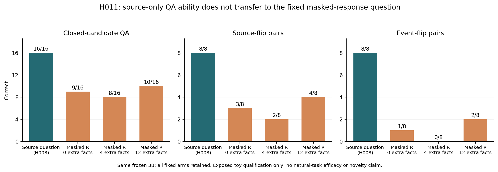

# H011：来源重建能力没有迁移到固定回答擦值问题

**资格实验失败。** 同一个冻结3B模型在H008来源独立问题上16/16；改为固定R擦值问题后，最短回答也仅9/16。没有调整模型、模板、温度、长度或权重。48原答、96槽、48唯一问题、96完整姓名＋EOS观测全部封存；实际前向12.3813秒，0unknown。

| 提问条件 | 正确QA | source flip正确反转 | event flip正确反转 | 构造回答 AUROC |
|---|---:|---:|---:|---:|
| H008来源定义问题（完整旧对照） | 16/16 | 8/8 | 8/8 | 1.000000 |
| H011擦值R，0条无关正确命题 | 9/16 | 3/8 | 1/8 | 0.625000 |
| H011擦值R，4条无关正确命题 | 8/16 | 2/8 | 0/8 | 0.656250 |
| H011擦值R，12条无关正确命题 | 10/16 | 4/8 | 2/8 | 0.625000 |

全部48答合并AUROC **0.6371528**，AP **0.6798580**。这是已暴露构造域的次级回答指标，不能冒充自然token指标或六任务结果。H008与H011的题面、独立观测数及条件前缀不同，不能称匹配计算预算或唯一内部因果归因。

## 错误的具体切入口：两个角色经常选择同一个姓名

事后读取封存的greedy选择，0/4/12负担下，8个来源分别有 **7、8、6个**在两个不同事件的目标问题上选择同一姓名；双正确分别1、0、2个；双反向均0。候选只有两人、两个正确角色不同且没有tie，因此有精确计数恒等式：

\[
N_{\mathrm{correct\ queries}}
=2N_{\mathrm{both\ correct}}+N_{\mathrm{same\ name}},
\qquad
8=N_{\mathrm{both\ correct}}+N_{\mathrm{same\ name}}+N_{\mathrm{both\ reversed}}.
\]

它解释了9/8/10这个行为计数，**没有引入新检测分数**。同名时选第一事件答案分别5/7、6/8、5/6，也不是一个普遍成立的“永远选第一项”规则。

这表明固定R擦值接口没有可靠地区分目标角色。最短条件已经失败，不能仅归咎于后缀。toy题面在逻辑上仍足以唯一确定两角色；这里没有证明擦除必然造成信息论不可识别、注意力因果或原生成器机制。也不能因本失败否定H008已通过的来源问答能力。

## 决定和后续

不调prompt/加大模型挽救本分数，不晋升自然QA。H012只做自然NER擦值、候选来源和未知原因的工程库存，没有QA效能主张。下一项可审查的结构性入口是：保留单一谓词及其角色锚，是否消除复合句的多角色耦合；或者从S独立构造问题再匹配R。两者必须先审查prior、真实请求身份和混杂，不能把旧句子scope、删后缀或换提示词改名重跑。

- [实际固定设计](../../refine-logs/h011-20261103/DESIGN.md)
- [完整角色坍缩审计](../../refine-logs/h011-20261103/role-collapse-audit.md)
- [完整96原始观测、预测及全部对照](h011_masked_reconstruction.json)
- [自然合同与既有文献](../../refine-logs/h010-20261103/NATURAL_CONTRACT_NEXT.md)

目标gold未参与本轮训练/选择；构造参考和完整旧H008对照只在观察与独立CPU实现冻结后释放。旧对照的初始CPU/观察seal及9资产一致，只有预声明的archive wheel、target名和prefix描述三项差异。外部NER库存也未用于替代本轮已知toy槽位。
