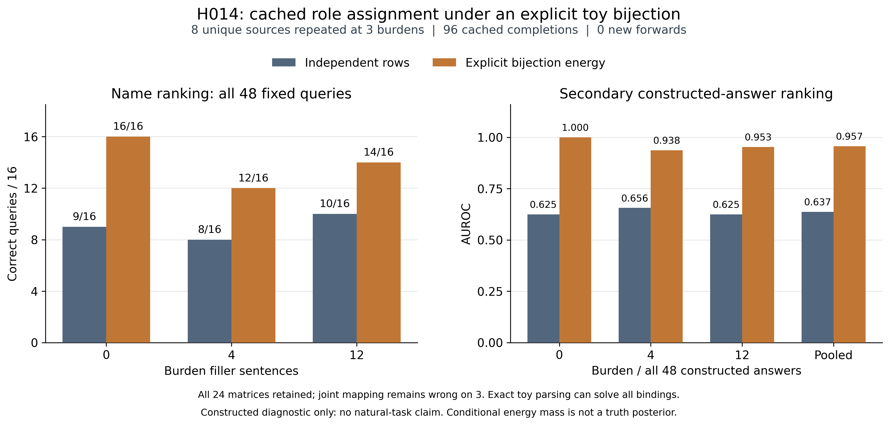

# H014：固定双射读出恢复部分 toy 关系排序，三组映射仍错

对 H011 已封存的 96 条完整姓名+EOS 分数复用原 H009 2×2 assignment kernel，新增模型调用为 0。固定联合读出在全部 48 个构造问句上的正确数从 27/48 变为 42/48；完整来源映射从 3/24 变为 21/24。结果说明这些固定分数中存在可由已知双射约束恢复的关系交互；**它不证明自然关系可可靠确认，也不证明需要 LLM**：toy parser 本来就能直接解出全部绑定。

全部独立/联合读出、0/4/12 负担层、24 个矩阵、48 个问句、48 个原答和 96 个 donor observations 均保留。24 个矩阵来自 8 个来源重复三层，不是 24 个独立来源；问句和原答共享分数，不能把 48 当作独立样本的自然效果评价。

| 负担 | 问句正确：独立 → 联合 /16 | 完整映射正确：独立 → 联合 /8 | 次级原答 AUROC：独立 → 联合 | 次级 AP：独立 → 联合 |
|---|---|---|---|---|
| 0 | 9 → 16 | 1 → 8 | 0.625000 → 1.000000 | 0.685218 → 1.000000 |
| 4 | 8 → 12 | 0 → 6 | 0.656250 → 0.937500 | 0.677611 → 0.947222 |
| 12 | 10 → 14 | 2 → 7 | 0.625000 → 0.953125 | 0.721456 → 0.959375 |
| pooled 48 原答 | 27 → 42 /48 | 3 → 21 /24 | 0.637153 → 0.956597 | 0.679858 → 0.959819 |

以上全部为构造域、已暴露的描述性诊断，没有 winner selection、阈值、温度、offset 或长度拟合。pooled AUROC 0.956597 不能写成六任务、自然数据或历史 BPE token 轴超过 0.8；这里评价的是构造原答及已知槽。

[独立 PDF 图](h014_cached_role_assignment.pdf) 由系统 Python 3.13.9、Matplotlib 3.10.6 实际生成，绘图耗时 4.288836700026877 秒；脚本与真实 runtime/hash receipt 保留于 outputs/h014-cached-role-assignment-20261103/plot_result.py 和 plot-runtime.json。没有安装依赖或计算新分数。

## 读出及可辨识范围

令行是来源中完整排序的两个事件，列是两个完整姓名，原始固定分数为 \(\ell_{ij}\)。只有 source 被严格 toy grammar 明确准入为双射后，才保留两种合法 assignment：

\[
E_{\mathrm{diag}}=\ell_{00}+\ell_{11},\qquad
E_{\mathrm{off}}=\ell_{01}+\ell_{10},\qquad
\Delta=E_{\mathrm{diag}}-E_{\mathrm{off}}.
\]

\[
w(\pi)=\frac{\exp E_\pi}{\exp E_{\mathrm{diag}}+\exp E_{\mathrm{off}}}.
\]

MAP 由原始 energies 的严格顺序决定，tie 与 unknown 均显式保留；原答 joint risk 为其观察 assignment 的 \(1-w\)，非双射/不可用时为 unknown risk 1。独立 baseline 保持 H011 的两槽风险最大值原样。这里的 mass 是给定两个合法 assignment 的条件能量质量，不是事实后验，也不新认证原分数为精确共同 LM 概率树。

21 个 independent same-name collapse 矩阵中，联合读出恢复 18 个，另外 3 个仍错；原来完整正确的 3 个矩阵均保留。三组失败完整列出，不只展示恢复案例：

| 负担 | 两个事件（canonical order） | 两个人名（canonical order） | 来源映射 | 联合 MAP | 原始 Δ |
|---|---|---|---|---|---:|
| 4 | Dalespar Cup；Raventon Cup | Evan Calderby；Sana Whitmere | [1,0] | [0,1] | 0.093761 |
| 4 | Nerowan Cup；Virelan Cup | Mira Tanswick；Oren Pellford | [0,1] | [1,0] | −0.406225 |
| 12 | Nerowan Cup；Virelan Cup | Mira Tanswick；Oren Pellford | [0,1] | [1,0] | −1.499977 |

完整 source/matrix IDs、四个原始分数、两种 energies、marginals、reference 与全部三层的每个 case 均保留在 [JSON 结果](h014_cached_role_assignment.json)。不同负担下并非所有 \(\Delta\) 都正确，不能从联合约束的恢复唯一归因为 additive name bias、内部 attention 或单一生成机制。H009 已说明 row/column additive nuisance 抵消是旧数学性质；本次没有重调 nuisance 来造优势。

## 自然前提与工程边界

[source-only Data2txt 库存](../../outputs/source-constraint-licences-20261103/README.md)显示：150 个来源可机械获得完整路径查值，但仅 23 个来源的完整非空 string leaf 映射为单射，所有来源都有多值容器，140 个有 null。即使字符串全唯一也不证明语义双射；path 功能性不要求原答提及全部 facts，更不许可所有原答槽是来源值的排列。因此不能把这里的全局 assignment 直接施加到自然 Summary/Data2txt。难点是可核的自然谓词、角色、行身份、alias、算术与非断言对齐；source 字段查值本身不需要 LLM。

H011 原始 independent 失败、全部 0/4/12 结果及 costs 原样留存。原 donor 成本为 96 forwards、32,816 input tokens、516 forced target tokens、0 generated tokens、12.381328800227493 秒；H014 新 forward 为 0。H013 另一次 separate-forward instrument 的质量门失败保持失败，不由本缓存读出补成功；H011 通过其既有 pool gate也不足以证明每个共享 causal prefix 的完整向量一致。本报告因此限于固定有限 energies 的读出诊断，不宣称 exact-LM probability、自然效能或方法晋升。

固定设计见 [H014 DESIGN](../../refine-logs/h014-20261103/DESIGN.md)。全部 scores、矩阵、case/readout、protocol 与 CPU source 在首次读取 H011 参考 packet 前冻结；随后完整重建旧 raw/query/case/summary。输出、初始 donor/reference seal、九个模型 assets 和 producer identity 在终端继续检查，禁止更换 donor 或丢弃错误矩阵。

运行 ID 为 383639f77106c62f795c25f5524ffec7e4073a30bd3c2bde76e237cc5834adba，状态为 sealed_cached_H011_assignment_diagnostic；registry outcome 为 inconclusive。结果 seal SHA256 为 450ca629b658321ae1a5e3e4032e98888650902d3ad32618a202723418bea74f，donor 初始 seal 为 545d732daa0edc8ac0f82036f6e687e6e2067052d7bc02ab4a0cce21c937c0a7，H011 CPU 参考初始 seal 为 3949813ad8a04511a892a41ebf19278a2d0b024f48dcc3881159fbb76f769551。124-file 核心 checkpoint 为 d9ce98f1a724c3fb1816e9f9ce41e6dad9caa138。原始大 reference packet 仍由成员 SHA256 绑定，不在公开 JSON 重复复制。
