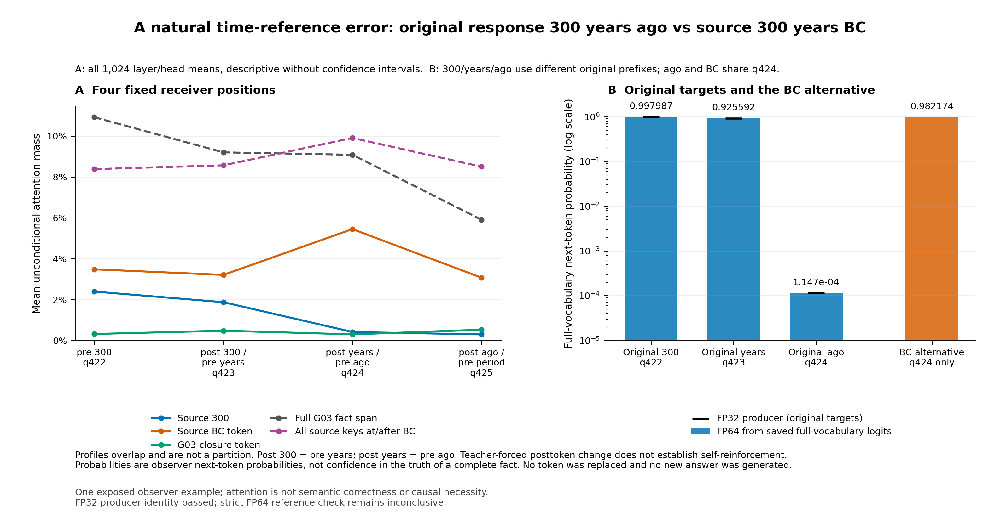
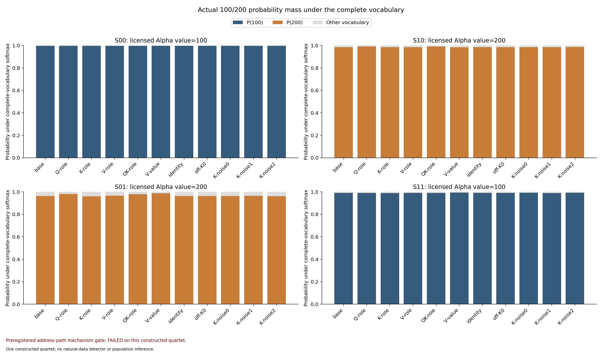
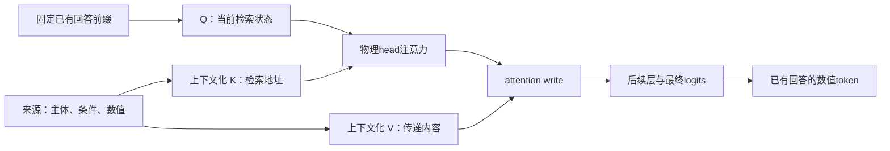

# H017：从数值命中到关系归属

## 2026-11-04：完整原回答检测评价

完整Data2txt900评价已完成：NLI外部监督对照AUROC/AP **0.744306/0.097168**，R4为**0.798318/0.190392**，V3为**0.755716/0.145209**。
全部900回答、150来源、6生成器、8240句、178343原token保留，unknown0；全量评分seal并通过独立无标签审计后才读官方标注。不是角色QA准确率。

| 方法 | AUROC | AP | TP | FP | FN | Recall |
|---|---:|---:|---:|---:|---:|---:|
| R4（历史冻结分数） | 0.798318 | 0.190392 | 2088 | 6830 | 5319 | 28.1896% |
| V3（历史冻结分数） | 0.755716 | 0.145209 | 1720 | 7198 | 5687 | 23.2213% |
| DeBERTa NLI（外部监督对照） | 0.744306 | 0.097168 | 1038 | 7880 | 6369 | 14.0138% |

固定全局最高5%的8918个token报警。NLI减R4的AUROC差为−0.054011，按来源配对bootstrap95%CI [−0.079074, −0.029124]；相对V3的AUROC差置信区间跨0，不能宣称显著差异。AP均较低。本轮没有建立新无监督检测器，也没有完成六任务各0.8目标。

文本对照的句级分数为 $s_t=1-\max_w P_{\mathrm{entail}}(S_w,R_{u(t)})$，再广播到原token；完整句分数不提供唯一错误token定位。原Llama机制实验、这份外部监督比较器及直接文本核验的效能边界分别报告。

[完整方法、成本、失败恢复与错例](h017_nli_detection.md) · [机器结果与SHA索引](h017_nli_detection_summary.json) · [M5有限机制证据](h017_scope_results.md)

下文保留各阶段的历史观察和当时边界；恢复执行以F054/D050与RESUME为准，不重开已关闭的M5/角色QA/等权分支。

研究对象是**已有回答中的幻觉**。例如来源“甲收入100、乙收入200”，回答“甲收入200”：找到“200”、对它有高注意力，并不说明找对了主体。当前研究检验检索地址、值传递与最终输出之间的关系，不再把改进限制在 V3 的概率差和平滑上。

**本轮已分出两种不同失败。** 时间单位例中，观察器反对错误的ago，旧读出削弱了已有告警；营业时间例中，来源内的多数时段被概括到例外星期，观察器对错误分钟仍给高概率。两类问题需要不同判别证据，不能把所有错误归结为没读条件或上下文平滑。新检测模块和AUROC提升仍未建立，下面保留实际实验、旧缓存新审查、严格失败检查和下一步边界。

软件验证：代码提交`9dc6600268be10e802418047a3b885ea2994b845`的[完整Linux CI](https://github.com/DwightEd/token_detector/actions/runs/41632218378)通过，1101 passed、1 skipped、9 subtests passed，191.65秒。测试的是已安装包并在checkout外执行；本机全套超时记录仍保留。这不代表新检测器有效。

**M5阶段记录：** [五世界实验](h017_scope_results.md)已完成5model/5head且0重复；三项冻结比较及独立全层头审计通过，仅排除严格全局区间频次解释。随后完整NLI对照也已评价，见本页开头。源码提交[`b362eff`](https://github.com/DwightEd/token_detector/commit/b362efff7ddb8e3806f04fd9ddb9bf0fd1969bd7)的[完整Linux Tests CI](https://github.com/DwightEd/token_detector/actions/runs/41724862885)已通过。

## 营业时间例：错误数值在原前缀下仍为高概率

继续审查原Data2txt首行`5670/source13601`，先独立冻结来源事实，再核对既有回答和旧概率缓存；没有新增模型、评分或评价标签。来源的周一为`17:30–23:00`，周二至周六为`17:00–21:00`，周日为`09:00–14:00`。回答却写成“Monday to Saturday from 17:00-21:00”。这是受限人工来源核验，不能当作新增benchmark gold或自动前端。

| 原回答位置 | 旧source条件概率 | 旧full gap | 解释 |
| --- | ---: | ---: | --- |
| 分钟00，target55 | 0.997455 | −0.205618 | 第一个与周一时段不同的数值位置；前缀已含Monday–Saturday和17: |
| 结束小时21，target57 | 0.999670 | −1.022722 | 此时已强制读入错误的17:00-，不能当作独立的首次选择 |

两个候选时段的开始小时同为17，仅测17是否出现或被关注不足以区分。**不能称整个时段高置信：** 原17的概率仅0.009706，连字符约0.095084；表中是原前缀下错误数值组件的条件概率。负full gap说明旧观察器在这些位置有来源时反而更支持原错误续写；这与ago的既有告警被聚合削弱是不同问题。

这份旧缓存审查只有BF16概率，没有同范围的Data2txt来源Q/K/V，不能推断它只看多数值、忽略周一、形成稳定错绑，或解释原GPT-4生成原因。原185个R IDs/offset匹配；native未另存独立prompt轴，原权重/producer身份仍有限制。native与primitive的gap严格比对8/370处失败，最大2 FP64 ULP，焦点53..59逐位一致，失败原样保留；未重新分词或重算排名。旧整体协议为offline，不能冒充在线因果检测器。[完整185词概率审计](h017_hours_probability_audit.md)保留全部数值、精度与输入边界。后续M5已补采匹配的FP32内部量，仍与这些旧BF16概率分开解释。

随后进入**固定原回答的范围条件对照**：比较完整时段词袋相同、例外在范围内/外的来源，并加入范围内例外迁移和实际token/位置审查；只复用既有no-op资格，不声称本轮重测成对no-op。它只能检验原Monday–Saturday子声明；改写来源都会破坏原回答后面的Sunday声明，不能称全回答真值翻转。五组现已完成，[实际结果](h017_scope_results.md)保留全部预定组和语义限制，不把它作为旧P021来源扰动分数的重新命名。起始[范围与原轴审查](h017_hours_scope_review.md)及[来源事实许可](h017_hours_source_review.md)保留原版本。

[CoCo](https://arxiv.org/html/2108.13134v2)、[FIB](https://aclanthology.org/2023.findings-acl.322/)等已有来源条件似然/错误文本复制偏好的研究；反事实、原子化或条件概率差本身不构成新贡献。[本次六项近邻审查](../research/h017_scope_literature.md)保留正文未获取等限制。需要检验的优势仍是原回答上的定位、检测或成本，而非给已知操作命名。

受控轮不采用第15层数值K交换作为关系检测依据：48次原模型完整前向、44次完整词表读出全部完成，耗时847.83秒；独立复核通过，属于科学负结果。K交换让3/4组的注意力地址向预期移动，但最终数值logit差在四组中都没有朝预期移动，且弱于范数匹配随机扰动。V的数值内容交换四组均产生预期方向的输出变化，但这还不是一个经过验证的检测模块。

## 自然轮：错误单位已被观察器反对

来源先独立许可，再检查原回答：`over 300 years BC`被写成`around 300 years ago`。完整441-token原Q/S/R保持不变，一次完整32层模型、一次76行词表head，67.24秒；保留全部32层×32头×77接收位置，所有原轴/旧native15及原生AV资格通过。

| 原回答词 | 预测概率 | 同一位置的首选 |
| --- | ---: | --- |
| 300 | 0.997988 | 300 |
| years | 0.925592 | years |
| ago | 0.000114724 | BC，概率0.982174 |

预测ago前，全部1024个layer/head的BC平均attention质量0.054506，数字300为0.004149。它们不是独立投票，也不是事实正确性概率；该例不支持“高概率错误单位、只看数字而遗漏BC”。source-reading Q仍未采集，不能用本观察推断原Mistral生成器原因或某条路径的因果必要性。

查看[全部32层×32头原值热图](h017_natural_figures/figure1_preago_all_physical_heads.png)、[完整76个原词及首选概率](h017_all76_token_probabilities.csv)和[独立解释报告](h017_natural_temporal_observation.md)。FP32生产概率逐位复现；独立FP64经验界在6/76行未过，仍记为inconclusive，未放宽。三词高低判断在两种精度一致，严格失败与全部raw logits保留。

## 旧方法：告警已出现，读出后名次下降

以下仅引用旧BF16系统的冻结记录，不由新FP32 trace反推因果。两者输入整数轴一致，但固定0.002跨运行logp容差44/76未通过，不能当作同次模型计算。

| ago的旧阶段 | 旧QA风险排名 |
| --- | ---: |
| 原full gap，值+3.28895 | 1165 |
| 实际point | 1492 |
| R4整句共享prior | 116867 |
| R4最终 | 114453 |
| V3自身witness | 1165 |
| V3最终 | 20219 |

旧QA告警预算为6241/124817。R4从full gap到point已由1165降至1492，在22-token整句prior处才首次跌出预算，其中19个contrast为负；V3的自身证据2.632417被−2.283023上下文差值抵消至0.349394。这是既有读出链的描述，不是新消融，也不证明共享推断整体无效。两处≤4.44e−16的严格primitive算术差异原样保留；实际native delta与full_gap输入逐位相等。完整身份与停止跨精度解释的依据见[旧链审计](h017_existing_readout_chain.md)。

下一设计必须引入可验证的**关系特异证据/原子事实粒度**，检验怎样保留这种条件矛盾而不误报合法改写、算术和范围未明确的回答；不能直接剪context、取max或再给方法任意权重。完整tuple许可、unknown、原轴输出、反例、对照与独立准入仍是先决条件，目前未准入新算法。

## 先看是否真的复现了所关心的错误

四组的回答始终固定为`Alpha revenue was 200.`，只测尚未读入200时，观察器给该原数值token的条件概率；不是整句判断正确率，也不是原GPT等生成器的抽样概率。

| 来源 | 是否支持固定回答中的Alpha—200 | 原p(100) | 原p(200) |
| --- | --- | ---: | ---: |
| S00：Alpha100 / Beta200 | 否 | 0.996614 | 0.00000927 |
| S10：Beta100 / Alpha200 | 是 | 0.000675 | 0.984020 |
| S01：Alpha200 / Beta100 | 是 | 0.000172 | 0.962136 |
| S11：Beta200 / Alpha100 | 否 | 0.990337 | 0.00025650 |

**这个简例没有复现高置信关系错绑。** 观察器在两个不支持回答的来源中已经强烈偏向100。因此不能用这组构造解释自然数据里的高置信漏报，更不能报告“检测全部正确”。它只提供正常检索中的受控路径检验。

## K地址变化与最终输出并不同步

方向化效应的正号，表示最终`z200−z100`向预定反事实数值移动；它不是AUROC或概率增量。

| 组 | K-role方向化logit效应 | 同范数随机K最大绝对效应 | V-value方向化logit效应 |
| --- | ---: | ---: | ---: |
| S00 | −0.036252 | 0.082509 | +0.230236 |
| S10 | −0.006172 | 0.149956 | +0.176146 |
| S01 | −0.012218 | 0.288387 | +0.980677 |
| S11 | −0.208561 | 0.413872 | +0.378428 |

K-role主门0/4通过；数值内容V-value对照4/4方向通过，且V-only臂的Q/K/attention与baseline逐位一致。完整事实换序的logit差为3.326567，超过所检验的K-role信号。同值替换、缓存独立性、全部32头的AV重放和预定调用数均通过，负结果不能归为仪器失败。

这拒绝的是**当前层、数字位置、特定干预的选择性输出介导**。它不证明K不含主体信息，也不能证明V效应具有自然幻觉检测特异性。后续不挑head、换层、改prompt来救这组正常检索简例。

M3受控轮没有观察postvalue，也没有保存来源读取阶段的完整query轨迹；“回答回声”“内部稳定关联”“回看整理节点”仍不能从该实验下结论。后续M4保存了原回答的post-token轨迹，仍未采集source-reading Q，也没有将稳定性当成正确性。

自然轮使用既有冻结panel中的两个RAGTruth QA来源及原始缓存，先做source-only事实许可，再审查已有回答的关系/条件诊断合同。它们分别涉及神话人物亲属关系和旗帜处理的条件范围，并非两个公司两个数值的双射。源文不明确的事实保持unknown，不读取评价标注来补齐。两个来源完成了人工许可；其中时间参照例随后完成一次原模型观测，没有产生新的检测分数。

来源事实先独立冻结，再查看固定Q/R后，`15716/source15540`出现时间参照问题。BC在来源数字之后，因果解码器的数字K/V不能依赖这次输入中未来BC，但可凭先验预测；回答query及其他后续来源状态也可能已经含有它。此后已实际完成上述M4全原轴观测，不再按两个主体交换数字来解释该自然例。

## 可直接查看的真实图与数据

[全部32头在condition/prevalue的数值关注](h017_figures/all32-head-condition-prevalue.png) · [全部干预与噪声对照的logit差](h017_figures/baseline-patches-noise-margin.png)。图中均明确标注科学门未通过，不能当作检测准确率。完整[44个读出端点](h017_figures/all-endpoints.csv)、[1536条物理head记录](h017_figures/all32-head-all-receivers.csv)、PDF/SVG及SHA来源在[图目录](h017_figures/FIGURE_MANIFEST.json)。

下述M0–M4机制资格本身不提供新检测AUROC；新NLI文本对照见页首。六任务各0.8的目标尚未完成。下表中的通过率都是仪器资格，不能当作幻觉检测准确率。

| 实际完成的工作 | 结果 | 能支持什么 |
| --- | --- | --- |
| 原始来源库存 | 2700回答、450来源全部保留；Data2txt识别5806个显式字段 | 获得原始位置与结构路径；QA/Summary散文的事实语义仍未知 |
| QA物理head缓存重放 | 900回答、150来源全部通过；5种错误实现各被900例拒绝 | 在冻结误差预算下，RoPE、GQA、因果/来源屏蔽与历史attention一致 |
| 原文与token轴 | 900回答全部匹配；复用3例，再完成897例 | prompt/R分开编码、source mask、T+1位置与原字符轴一致；语义关系仍未评估 |
| 原权重前缀复现 | 原样本16465，完整252-token prompt；正常/阻断两次运行均通过，46.40秒 | 第15层三处hidden与Q32/K8/V8前缀坐标可在本机复现；尚非最终输出因果证据 |
| 完整head/cache/no-op | 4次完整模型、3次原生完整词表head，101.08秒；全部通过 | 缓存查询与bulk输出一致；同值Q/K/V干预的hidden、logits、logp逐位不变 |

缓存核验复用3例已封存结果，再完成其余897例，没有重新计算已通过的样本。local attention最大绝对误差0.00164831，group mass最大绝对误差0.00224179；全部坐标的误差/允许误差小于1，且没有precision unknown。原始模型四个BF16分片共16.06GB，哈希与历史捕获匹配；本机逐层加载，沿用原FP32算术，未用量化模型替代。

完整证据位于`outputs/h017-relation-20261103/`：`M1_900_AGGREGATE.json`保存两次真实run及逐head汇总，`m3-prefix/`保存原模型前缀计划、坐标比较、资源记录与seal。下载文件统一位于数据根目录，未混入Git。

完整输出门的bulk/cache最大hidden误差为0.00004721、完整128256词表logit误差为0.00005341、原回答首token的logp差为0.00001288，均在前向前冻结的预算内。同值干预误差为0；32层缓存独立、原缓存不变。GPU峰值实际分配3.36GB、保留4.23GB。该结果只使后续干预可解释，不表示原回答正确或新检测器有效。

全900例对齐包含124817个回答token、125717个query位置；来源occurrence按回答映射为9384个完全包含、12个边界相交，边界相交原样保留。当前tokenizer与旧缓存的操作性一致，不代表已补齐历史tokenizer文件哈希，也不代表事实归属已解决。两次真实运行保存在`M2_900_AGGREGATE.json`。

## 真正需要区分的机制

单个head的输出为

$$o_{t,h}=\sum_{s\leq t}\operatorname{softmax}_s\left(\widetilde q_{t,h}^{\mathsf T}\widetilde k_{s,h}/\sqrt{d_h}\right)v_{s,h}.$$

Q/K决定如何寻找来源位置，V参与传递被取到的内容，后续层和最终读出决定说什么。这个分解本身不能证明某个head保存了纯粹的主体或数值。需要真实干预，并用最终原回答token的logit检验，而不能只看局部attention或hidden相似度。

完整head、prefix cache及同值Q/K/V干预先通过无变化验证。已完成的科学实验固定四组来源、相同回答和第15层全head干预，未根据目标标签选择head或阈值：

| 来源组 | 第一条事实 | 第二条事实 | 相对原组的变化 |
| --- | --- | --- | --- |
| 00 | 甲100 | 乙200 | 原组 |
| 10 | 乙100 | 甲200 | 仅换主体，数值与位置不动 |
| 01 | 甲200 | 乙100 | 仅换数值 |
| 11 | 乙200 | 甲100 | 完整事实换序，与00含义一致 |

回答始终固定为“甲收入200”。预先固定的主要终点是原数值token相对备选数值的最终logit变化，已测试Q、K、V、Q+K、同值和随机对照，保留全部预定结果。完整事实换序只提供保义对照，不能把跨位置坐标直接当作同位置干预。该受控实验只检验局部机制，不能替代真实回答的检测比较。

本次已按预定规则拒绝这条选择性K介导读出，不事后挑head补救。下一阶段仍需先有可靠的原回答风险接口，才能在相同事实候选、覆盖和预算下与R4/V3及直接文本核验比较；评分冻结后才读取真值。外部监督文本对照的训练暴露与截断合同也须单列，不把它冒充新无监督机制。

## 文献定位

[Binding IDs](https://arxiv.org/html/2310.17191v2)提供表示交换的先例；[EMNLP 2026重绑定研究](https://aclanthology.org/2026.emnlp-main.1238/)发现Llama与Gemma的绑定信号并不完全相同，不能预设通用Q/K机制。[输入侧证据对齐研究](https://arxiv.org/html/2608.15804v1)也报告相矛盾片段可能高度相关。它们支持进行上述区分实验，没有证明当前自然错例已由该机制解释。

完整文献审查、监督方式与近邻差异见[本轮调研](../research/20261103_relation_misbinding_followup.md)。当前进度与下一问题以[恢复记录](../../research-state/RESUME.md)为准；计划、已运行实验和检测效果分别记录，避免上下文压缩后重复实验或扩大结论。

Q/K/V与最终读出之间的[逐步推导](../research/h017_path_derivation.md)区分了局部恒等式、最终输出因果和检测效果。精确冻结的[四来源协议](../research/h017_address_payload_protocol.md)及其[独立科学审查](../research/h017_address_payload_review.md)可直接在GitHub查看公式与实验门槛。
