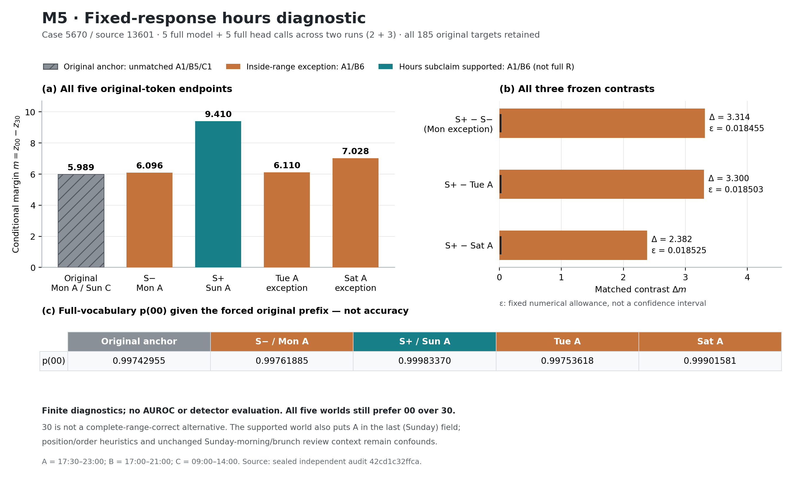

# M5：范围内例外会影响预测，但高概率仍不等于关系正确

**五组已实际完成，三项预先固定的比较全部通过，独立数值审计通过。** 这是一条既有回答的受控机制诊断，还不是新检测器或自然任务AUROC。

原来源：周一17:30–23:00，周二至周六17:00–21:00，周日09:00–14:00。原回答却把17:00–21:00概括为周一至周六。回答的所有185个token保持不变，每组输入均1079token；四个受控来源各含一个A=17:30–23:00、六个B=17:00–21:00，只移动例外的位置。

## 实际结果

主量是原回答预测分钟00前的 `m=z00−z30`。30借自来源17:30，并不是整个Mon–Sat的正确替代答案；这个差不是事实支持概率。

| 来源 | A例外所在日 | hours对象是否支持Mon–Sat全部B | m |
| --- | --- | --- | ---: |
| 原来源（非匹配锚点） | 周一；周日另为C | 否 | 5.988808 |
| S_minus | 周一 | 否 | 6.096447 |
| S_plus | 周日，在声明范围之外 | 是 | 9.410328 |
| Tuesday_exception | 周二 | 否 | 6.110023 |
| Saturday_exception | 周六 | 否 | 7.027855 |

S_plus减周一、周二、周六例外的主差分别为 **3.313881、3.300304、2.382473**，均超过调用前冻结的工程数值界约0.0185。原来源不参与匹配门；次要的七个原时段token似然不能补救主门失败。所有预定组均保留，没有按结果换层、挑头、换范围或挑某个数字。

[PDF](h017_scope_figures/m5_scope_diagnostic.pdf) · [SVG](h017_scope_figures/m5_scope_diagnostic.svg) · [全部端点CSV](h017_scope_figures/five_endpoints.csv)

因此，严格“只看全局完整时段计数”的模型不能解释这组差异。但它仍可能利用日期、位置或序列末端启发。三个同样不支持该声明的组之间也有0.931408的margin跨度，不能把它写成已经发现了通用全称范围核验算法。原来源对00仍给0.997430概率；关系敏感性本身没有变成可用的事实风险。

## 内部量与独立复核

每组保留32层、每层全部32个物理头，以及六个原回答接收点和七个来源字段完整闭合接收点，共13个位置的Q、原生cos/sin、pre-O AV、全输入原生post-RoPE KV和完整185行词表logits。闭合位置只说明完整字段已可被读取，不证明某个状态编码、使用了正确关系，也不证明存在回看验证节点。

独立审计重放了全部925个原目标的FP32生产概率元数据，逐位相同；NumPy FP64独立重放全部层头的RoPE/GQA/因果attention与AV，在原固定界内0违反，最大AV绝对差7.47868e−6。未来位置attention为0，全部保存的profile精确复现。头与层相关，不能当作数千个独立样本。

首轮两组各完成完整模型/head后，进度文件的禁止覆盖保护触发工程错误。两组结果和失败记录原样封存；修复仅涉及I/O，独立检查数值函数AST、137项其余依赖与旧封存后，只续跑剩余三组。真实调用总数仍是 **5model/5head，0重复**。首轮103.90秒、续跑149.79秒；含两次启动等开销，不是纯GPU计算时间。

实测显存峰值约3GiB，运行后空闲物理内存约1.2GiB。该次停止是编排错误，**并非资源拒绝或OOM**。所有模型与独立审计进程现已退出。

## 必须保留的语义限制

- 所有受控来源都会破坏原回答后面的Sunday时段声明，不能称全回答真值翻转。
- 来源评论提到Sunday morning/brunch，而受控hours变成晚间；评论有历史日期、hours没有生效日期，其完整上下文张力未消解。结论只针对许可的hours对象，不声称整个来源无矛盾。
- 此例来自已暴露的首行自然样本，人工许可不是自动前端，也不是新增benchmark gold。
- 没有对原GPT-4生成器作白盒观察，没有证明因果电路、自然覆盖、定位优势、低成本优势或新AUROC。

完整数值、实际输入和失败/复用收据见[结构化汇总](h017_scope_summary.json)；本机完整证据在`outputs/h017-relation-20261103/m5-postrun-audit-v1`及`m5-postrun-input-supplement-v1`，大缓存不进入Git。

下一步是完整Data2txt900的本地文本核验对照。它将产生原回答全部178343token上的风险、unknown与最终AUROC/AP；监督来源、窗口合同和费用单列。不能继续用本单例的控制实验代替检测评价。
