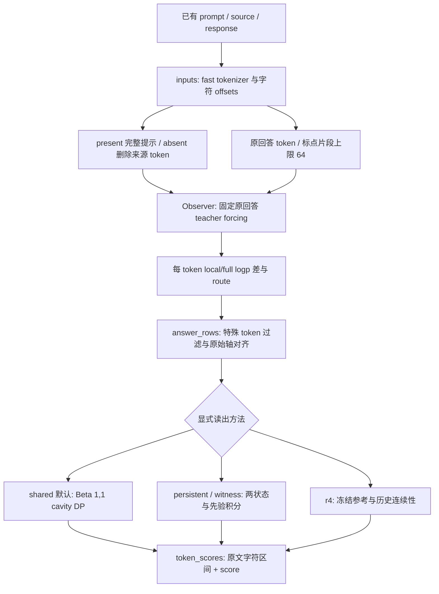

# 从输入到 token 分数：库调用路径

当前研究对象以 [V3 / witness](METHOD_V3.md) 为基础；本页解释包含 V1 默认值和历史 R4 的完整库调用链。请先看 [全数据集对照](../RESULTS_CURRENT.md) 与 [组合方法设计](INTEGRATED_DESIGN.md)。下文 V1 的保序定理不适用于完整 V3。

阅读基线是 Git 提交 `1210120748b3a05bd271bc79debcbed4fdc0c964`。先理解本文，再打开 [逐行阅读器](READING.html)，最后看 [数学证明](THEORY.md)。代码中 `myproject` 是包名；GitHub 仓库是 `token_detector`，不是当前另一项目 Paper-Analysis-Viewer。

## 先区分三个概念

1. **检测目标**：回答内容是否受给定来源支持。来源本身可能是错的；一个现实中为真的回答也可能不在来源中。外部事实真伪与来源支持性需要分开标注。
2. **当前实际观测**：同一冻结语言模型在有来源/删除来源时，给已经生成的每个 token 多大概率；另有局部历史、注意力路由、全词表等可选观测。
3. **当前输出**：这些观测在某个声明的专家混合模型下的状态 log odds，或历史 R4 的组合分数。没有独立识别/校准步骤就不能叫“错误概率”。

共享先验、动态规划和精确积分已经是数学结构。研究缺口在于它们为什么能识别目标错误、相对最近工作新增了什么，以及真实数据是否支持局部定位主张。

## 实际执行步骤



**第一步，确定读出配置。** `api.HallucinationDetector.__init__` 默认构造 `SharedDetector(method='shared')`。旧 R4 要传 `method='r4'`。`from_pretrained` 中显式 references 路径也会默认选 R4。Oct31 论文讨论最多的 witness/V3，不是目前不传参数时的默认方法。使用结果前必须记录确切 method，而不能只说“当前方法”。

**第二步，来源与回答编码。** `inputs.encode_source` 要求来源是 prompt 中唯一非空子串，先渲染 chat template，再按字符 offsets 标记来源。absent 通过删除与来源重叠的整枚 token 构造，不重新分词。`encode_response` 保留原 IDs、offsets 和特殊 token 集合。`text_units` 按换行/句末标点分段，并将长段切为最多 64 token 的片段。中文无空格句界、逐 token decode 的 Unicode 边界是需要观察的边界情况，不把这个函数当通用句法分析器。

**第三步，执行观测。** `Observer` 缓存各层 W_O 投影 Gram。每个来源世界先 prefill 提示的前 P−1 个 token；查询序列是最后提示 token 加 y 的前 N−1 项，所以查询位置 P+t−1 预测 y_t。两种世界都保留原回答历史 y_<t；不会生成新回答。完整历史结束后将 KV 裁回提示前缀，再逐片段计算仅使用片段内历史的 local 似然。来源 present 完整历史还收集 eager attention 路由；absent 和其他似然路径使用 SDPA。这是当前实现，解释来源效应前必须做匹配后端对照。

**第四步，构造并对齐观测。** `Observer.measure` 输出 delta[N,2]：第 0 列 local absent−present，第 1 列 full absent−present。`measure.answer_rows` 保留 offsets 非空且非特殊 token，形成 M 行有效轴。target[M] 仍指原回答 token 下标；不得删中间 token 后把它当原始相邻位置。所有字段同一次过滤，最终字符展示直接切原始 response。

另一个已经存在的观测入口是 `measure_responses → counterfactual.observe_responses`：只测 full logp、两个世界都使用 SDPA、没有 local/route。`experiments.fullgap_dataset.collect` 实际调用此入口并记录 matched_sdpa。因此上面的四种观测流程是默认文本 API 的完整过程，不代表每个实验都做了 local/route，也不能把默认 API 后端差异当作所有历史实验的缺陷。不同变体保留各自 [N_j,2] raw logp 轴，再按原 offsets 投影。

**第五步，按一种声明模型读出。** 默认 shared 只读取 delta[:,1]，按 (answer_index,unit_index) 连续范围独立求 Beta(1,1) cavity odds。它保留每个 token 自证据，但严格保留同片段内 raw gap 的排序。persistent 用共享 π 和复制强度 c 的两状态链；witness 将 absent 专家替换为半 present/半 absent 的混合。R4 则按任务选 source view，计算温度片段先验、原 target 距离窗口、参考分位数、局部中心化创新及有界连续性消息。这些是不同算法，不应把其推断结果混为一个统计对象。

**第六步，呈现与评价。** `token_scores` 输出 token_id/text/start/end/score。库推断静默、内存运行，CLI 才读写 JSON。实验通过 seal/hash 验证冻结分数后读标签；`experiments/fullgap_dataset._paired_views` 报告按来源聚类的比较。新增加的 AUC 分解只在评价阶段计算，绝不会成为模型输入。

**可选proof_revision步骤**：`proof_pack → proofs.compile_proofs` 先解析有限JSON年份表与直接/二元金额声明。只有封闭、无歧义且token可投影的不兼容声明生成修复DNF；其他情况unknown或中立。`revise_scores` 先得V3 witness基线，以role命中bit扩展状态空间，再在关联块上精确求修复事件条件概率，最后以KL预算限制相对基线的概率修改。见[变分推导](THEORY.md#9-proof_revision-已实现的有限语法与-kl-投影)。这条分支的score是有界诊断概率，不能与shared/witness的log odds直接当同一尺度比较；也没有把自由散文中的事实错误变成已证命题。

## 输入输出与状态所有权

| 边界 | 主要输入 | 输出/副作用 | 关键失败边界 |
|---|---|---|---|
| encode_source | tokenizer、prompt、source | 两个提示 IDs 与来源 mask | 来源缺失/重复、模板改写、无 offsets |
| encode_response | tokenizer、response | 原 IDs/offsets/units | tokenizer 与模型必须匹配 |
| load_model | 本地路径、device | BF16 eval 冻结模型；修改 TF32 全局标志 | 本地资源/设备/架构不匹配 |
| prefill | 模型、tokens | 新建并增长 DynamicCache | Llama 风格主干接口 |
| score_continuation | cache、最后提示 token、回答 | logp[N]；cache 原地增长 | 低层要求非空回答/无梯度上下文 |
| source_condition | 一种提示、回答、片段 | local/full/可选 route | units 应完整不重叠覆盖 |
| Observer.measure | 两世界编码、回答编码 | delta[N,2] 等；自身 Gram 复用 | 词表块配对、eager hook 结构 |
| answer_rows | 观测、编码、回答 ID | 有效 M 行 pack | 原 token ID 不同则拒绝 |
| SharedDetector.score | pack | score[M]，无跨回答状态 | 指定方法缺额外观测时拒绝 |
| Detector.fit / score | pack / references | FIT 更新参考；score 不训练 | R4 未 FIT/加载不能预测 |
| token_scores | pack、编码、score[M] | JSON 兼容记录 | strict zip 检查长度 |

常用 caller 链：CLI `run.main → from_pretrained → predict → measure → encode_* / Observer.measure → source_condition → prefill / source_full / score_continuation`；之后 `answer_rows → readout.score → grouped_scores → cavity_scores → forward/_terminal`，最后 `token_scores`。可选 dependency 链走 `attention_profiles → legal_atoms → segment/predictive_segment`；它使用 P+t 的 post-token 位置，而似然是 P+t−1，不能混用。

## 伪代码与复杂度

```text
输入冻结模型 θ，来源 S，提示 x，已有回答 y；固定分段 U
分别构造含来源与删来源的 token 提示
对 y 的每个原位置 teacher-force 两个世界，得到 d_t=log q0(y_t)-log q1(y_t)
保留非特殊、正字符长度的原 token，保持 target 轴
对每个原片段 u:
    shared: 前向计数 DP + Beta 终端 + 后向 cavity
    输出 s_t = d_t + cavity_t(d_除自身)，a=b=1
按原 offset 返回每个有效 token 的 s_t
```

冻结 LM 观测成本通常主导，但不能用“两个世界”等同“仅两次 backbone 调用”：分块、local 重置及可选 attention 分段均增加实际 forward。共享 DP 单片段 O(n²) 时间/内存；默认 π,c 积分 persistent/witness 为 O(n³)。R4 链消息 O(M)，窗口/参考搜索另计。当前默认库即便只用 full gap，仍测 local/route；这是可优化的成本边界，但本轮没有为了提速改变冻结测量数值。

## 研究与工程对应的知识点

| 位置 | 真正实现的概念 | 不应凭名称推断 |
|---|---|---|
| model.score_continuation | 自回归右移、teacher forcing、KV cache 原地扩展 | 未执行采样生成或训练反传 |
| routing.observe_route.observe/record | 闭包绑定层号、forward hook 生命周期 | 未对 attention 图作随机游走 |
| pooling.forward/cavity_scores | log semiring DP、精确边缘化、cavity | 不是 token 平均，也不是事实概率校准 |
| sequence._grid/persistent_scores | 正权重求积、隐状态前后向、联合证据加权 | 不是均匀平均每个节点后验 |
| graph.chain_log_odds | 二状态链 sum-product | 不是 Viterbi MAP 解码 |
| distribution.conditional_observations | 词表归一化、ties 完整尾质量、预测校准 | 不保证真实数据服从模型分布 |
| experiments.local_evaluation | token 对排序、来源聚类不确定性 | token 对不是独立数据量 |

分布式训练、服务并发安全、持久化模型检查点、RL、检索器训练均不在当前推断实现内；它们属于外部调用或未实现范围。

## 可复查的本地操作

在仓库根目录，Windows PowerShell：

```powershell
.venv/Scripts/python.exe -m pytest tests/test_pooling_theory.py tests/test_auc_decomposition.py -q
.venv/Scripts/python.exe -m myproject --help
```

这些只验证 CPU 数值机制和命令入口。实际模型预测需要本地模型文件与合适设备；本轮没有运行新的 LM/GPU 或标注实验。逐行覆盖不由测试通过率替代；完整剩余范围见 [SOURCE_INVENTORY.json](SOURCE_INVENTORY.json)。
